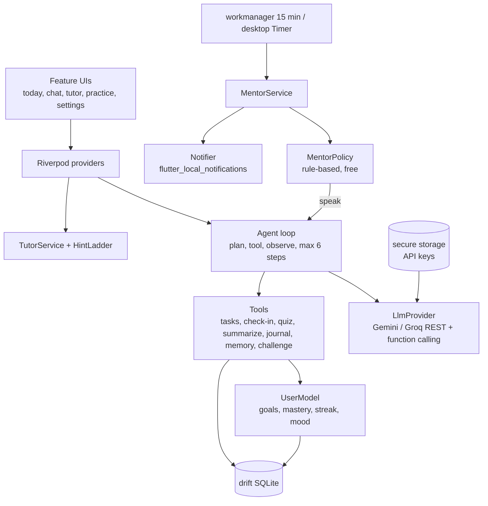

# Architecture

Local-first Flutter app (Android + Windows). No backend; the user's own LLM key talks directly to Gemini or Groq.

## Layout
- `lib/core/` db (drift), llm providers, secure key store, notifications, v0.2 stubs (`sync/`, `usage/`).
- `lib/features/<name>/` agent (loop, tools, prompts), memory (UserModel), mentor (policy, service, background), tutor, challenges, today, chat, onboarding, settings.
- `lib/app/` app shell, Riverpod providers, composition.

## Key flows
1. **Silent by default**: every tick builds a `MentorState` from the DB and asks `MentorPolicy.decide` (no LLM). Only on "speak" is the agent called; failures fall back to an offline line.
2. **Silence budget**: max 3 proactive messages/day, 90 min gap; ~25% deliberate non-intervention on non-urgent nudges.
3. **Fading help**: `HintLadder.cap(mastery)` — strong learners never get the answer, only a hint.
4. **Tone**: mood <= 2.2 -> gentle; missed tasks/broken streak -> firm; otherwise warm.
