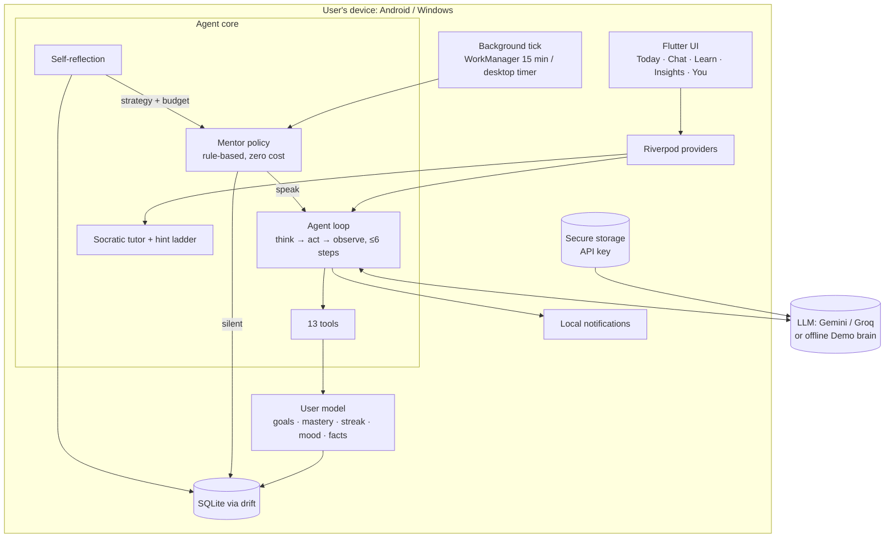
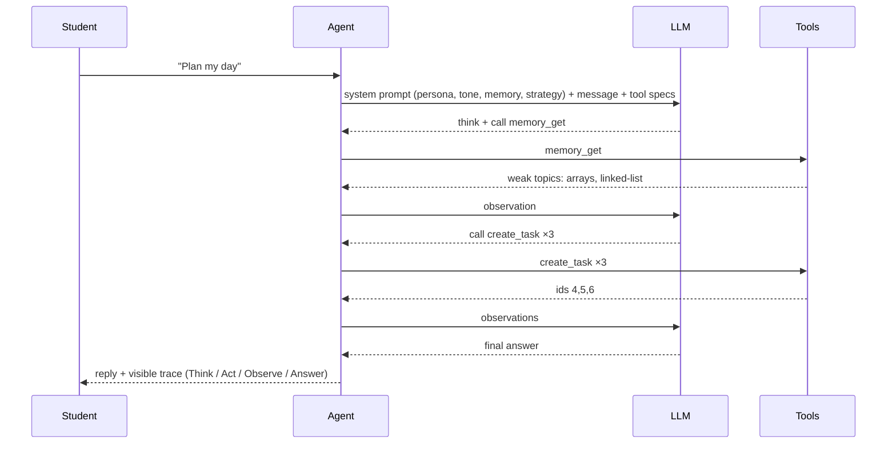
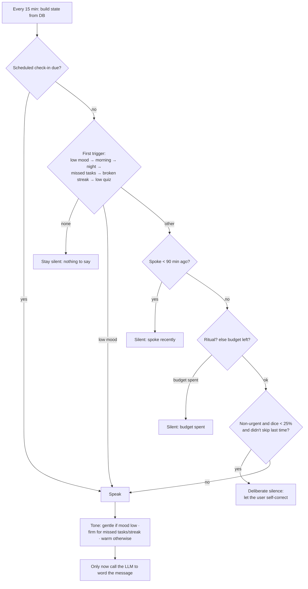

# Dotbot: A Proactive, Self-Reflective AI Mentor Agent that Makes Its User Independent

**Project report** · Aamir · B.Tech CSE (2nd year) · 2026

---

## Abstract
Most AI assistants are reactive chatbots: they answer whenever asked and are designed to maximise engagement. Dotbot is an **autonomous agent** with the opposite goal. It is **silent by default**, decides **on its own** when speaking will actually help, sometimes stays quiet **on purpose** so the student can self-correct, and **fades its help** as the student's skill grows. It perceives the user's state (tasks, quiz results, mood, journal), keeps **long-term memory**, **plans and acts** through 13 tools in a ReAct-style loop, and **reflects on its own behaviour** every night to adapt how often and in what tone it speaks. It runs fully on-device (Flutter, Android + Windows) with the user's own free Gemini or Groq key, plus an offline demo brain. In a 60-day synthetic evaluation it used **3.6 messages/day versus 64** for an always-nudge bot on a struggling student, while answering **100% of low-mood moments** within an hour.

## 1. Problem
Engineering students preparing for placements (Java + DSA) juggle study plans, low motivation, loneliness and phone distraction. Existing tools fall short in three ways:
1. **Reminder apps** are dumb: fixed times, no context, easy to ignore.
2. **Chatbots** are reactive and encourage dependence: they give full answers immediately and want more screen time.
3. **Coaching** is expensive and not available at 11 pm.

**Goal:** an agent that behaves like a good mentor: present at the right moment, quiet otherwise, honest, caring, and actively working to make itself unnecessary.

## 2. Objectives
| # | Objective | Where it is met |
|---|---|---|
| O1 | Decide autonomously *when* to speak, including deliberate silence | Mentor policy (§5.3) |
| O2 | Use tools to act, not just talk | Agent loop + 13 tools (§5.2) |
| O3 | Remember the user long-term; let the user see and delete it | Memory module (§5.4) |
| O4 | Reduce help as skill grows | Hint ladder (§5.5) |
| O5 | Improve its own behaviour from outcomes | Nightly self-reflection (§5.6) |
| O6 | Care without dependence; privacy by design | Prompt rules, on-device storage (§7) |
| O7 | Show it works | 61 automated tests + simulation study (§6) |

## 3. Background
- **ReAct** (Yao et al., 2023) interleaves reasoning and tool actions; Dotbot's loop follows this *think → act → observe* pattern and shows each step to the user.
- **Reflexion** (Shinn et al., 2023) lets agents improve from self-written feedback; Dotbot's nightly reflection grades its own nudges.
- **Generative Agents** (Park et al., 2023) showed the value of long-term memory streams and reflection for believable agents.
- **Scaffolding** (Wood, Bruner & Ross, 1976) and **productive failure** (Kapur, 2008): learners grow most when support is just enough and is withdrawn as competence rises. This motivates the hint ladder and deliberate silence.

## 4. What makes Dotbot an *agent* (not a chatbot)
| Property | Chatbot | Dotbot |
|---|---|---|
| Initiative | Only replies | Decides when to start a conversation |
| Perception | Current message | Tasks, deadlines, quiz history, mood, journal, time of day |
| Action | Text only | 13 tools that change the world (plan, schedule, record, remember) |
| Memory | Session only | Persistent, inspectable, deletable facts + user model |
| Self-improvement | None | Grades its own nudges nightly and adapts |
| Goal | Engagement | User independence |

## 5. System design

### 5.1 Architecture


### 5.2 Agent loop and tools

The loop is provider-neutral (`LlmProvider` interface with Gemini, Groq/OpenAI-compatible and an offline `DemoProvider`). It stops after **6 steps**, then forces a tool-free answer. Tool errors become observations, never crashes.

| Tool | Purpose |
|---|---|
| create_task / update_task / complete_task / list_tasks | Day planner |
| schedule_checkin | User-requested future check-in |
| tutor_quiz | Record quiz results, query allowed hint level |
| summarize_text | Read pasted text or a PDF (pdfrx) for summarising |
| journal_read / journal_write | Stoic journal |
| memory_get / memory_update / memory_remember | User model + long-term facts |
| offline_challenge | LLM-free practice from weak topics |

### 5.3 Mentor policy: when to speak

Key ideas: the **silence budget** (3/day, adapted 1–4 by reflection), a **90-minute gap**, **deliberate non-intervention** (25%, never twice in a row, never for mood or rituals), and **care first** (low mood bypasses everything). The LLM is called **only** when the policy says speak, which protects the free-tier quota.

### 5.4 Memory and data model
```mermaid
erDiagram
  TASKS { int id; string title; string topic; datetime dueAt; datetime doneAt }
  JOURNAL_ENTRIES { int id; string kind; string body; string agentQuestion }
  MOOD_LOGS { int id; int mood; int energy; datetime at }
  TOPIC_MASTERY { string topic; float mastery; int attempts }
  QUIZ_RESULTS { int id; string topic; bool correct; int hintLevel }
  FACTS { int id; string category; string content; string source }
  MENTOR_EVENTS { int id; string trigger; bool spoke; string reason; string tone; bool effective }
  REFLECTIONS { int id; string day; string summary; string strategy; json stats }
  CHAT_MESSAGES { int id; string role; string content; json trace }
  QUIZ_RESULTS }o--|| TOPIC_MASTERY : updates
  MENTOR_EVENTS }o--|| REFLECTIONS : graded_by
```
Mastery per topic is a moving average: `m ← 0.8·m + 0.2·credit`, where credit is 1 for an unaided correct answer, reduced by 0.2 per hint level (min 0.2), and 0 if wrong. The **Memory page** shows every fact with its source (user / agent / reflection) and a delete button.

### 5.5 Socratic tutor: help that fades
| Mastery | Starts with | Most help allowed |
|---|---|---|
| < 20% | hint | full answer |
| 20–40% | guiding question | full answer |
| 40–70% | guiding question | partial skeleton |
| ≥ 70% | guiding question | one hint only, so the student must finish |

### 5.6 Self-reflection: the agent judges itself
Every night (or on demand) Dotbot:
1. Grades each nudge it sent: **effective** if the student completed a task, answered a quiz or journaled within 2 hours.
2. Computes per-tone success, quiz accuracy, hint use, mood and tasks done.
3. Adapts: ignored nudges reduce the daily budget (speak less), effective ones allow one more; it notes the best tone and whether to hold back help.
4. Writes a first-person summary (LLM, with a template fallback) and a **strategy note that is injected into tomorrow's system prompt**.

## 6. Implementation and testing
- **Stack:** Flutter 3.47 (Android + Windows), Riverpod, drift/SQLite, flutter_secure_storage, flutter_local_notifications, WorkManager, pdfrx (MIT), REST to Gemini/Groq.
- **Engineering:** feature-folder structure, ADRs, decision log, CI on GitHub Actions (analyze, test, APK and Windows build artifacts on every push).
- **61 automated tests**, including: agent loop with a fake LLM (tool use, step limit, error handling), both providers (HTTP mocked), mentor policy (13 cases), mentor service, hint ladder, tutor, reflection (grading and adaptation), user model, every screen at phone and desktop sizes, and a **full simulated day** that checks every agent behaviour end to end.

### 6.1 Evaluation
A simulation (`tool/evaluate.dart`) runs 60 days × 3 student profiles with identical random seeds for three strategies. Full table: [EVALUATION.md](EVALUATION.md).

| Profile | Strategy | LLM calls/day | Low mood answered ≤1h | Rituals written |
|---|---|---|---|---|
| average | **Dotbot** | **2.3** | **100%** | **88%** |
| average | Always-nudge bot | 8.6 | 100% | 83% |
| average | Fixed reminders | 3.0 | 62% | 28% |
| struggling | **Dotbot** | **3.6** | **100%** | **83%** |
| struggling | Always-nudge bot | 64.0 | 100% | 75% |
| struggling | Fixed reminders | 3.0 | 45% | 28% |

**A finding that changed the design:** the first evaluation showed Dotbot answering 0% of low-mood moments for the struggling student, because repeated quiz nudges spent its budget. The policy was changed to *care first* and *one-shot nudges*, which brought it to 100%.

## 7. Ethics, privacy and healthy use
- **On-device first:** all data in local SQLite; the API key in OS secure storage; only the prompt for a reply goes to the chosen LLM. Offline demo mode sends nothing.
- **Transparency:** reasoning traces on every reply; a decision log showing why it spoke or stayed silent; a Memory page with per-item delete and "forget everything".
- **Not a crutch:** the system prompt forbids encouraging more time with the agent; when lonely, it comforts briefly and then points to real people and the outside world. It never claims to be human.
- **Suggest only:** no screen locking or accessibility powers; minimal permissions (internet, notifications).

## 8. Limitations and future work
- The evaluation is synthetic; next is a 2-week pilot with classmates (pre/post survey, task completion, self-reported dependence).
- Windows ticks only while the app is open; Android relies on WorkManager (≥15 min).
- Planned: adaptive timing that learns the best hours to reach the user (bandit), relationship reminders (call family/friends), health routines, Hinglish voice, encrypted optional sync.

## 9. Conclusion
Dotbot shows that an AI agent can be designed around the user's **independence** rather than engagement: it perceives, remembers, plans with tools, decides when *not* to act, and improves itself from outcomes, all on-device and explainable.

## References
- Yao, S. et al. (2023). *ReAct: Synergizing Reasoning and Acting in Language Models.* ICLR.
- Shinn, N. et al. (2023). *Reflexion: Language Agents with Verbal Reinforcement Learning.* NeurIPS.
- Park, J. S. et al. (2023). *Generative Agents: Interactive Simulacra of Human Behavior.* UIST.
- Wood, D., Bruner, J. S., & Ross, G. (1976). *The role of tutoring in problem solving.* Journal of Child Psychology and Psychiatry.
- Kapur, M. (2008). *Productive failure.* Cognition and Instruction.
